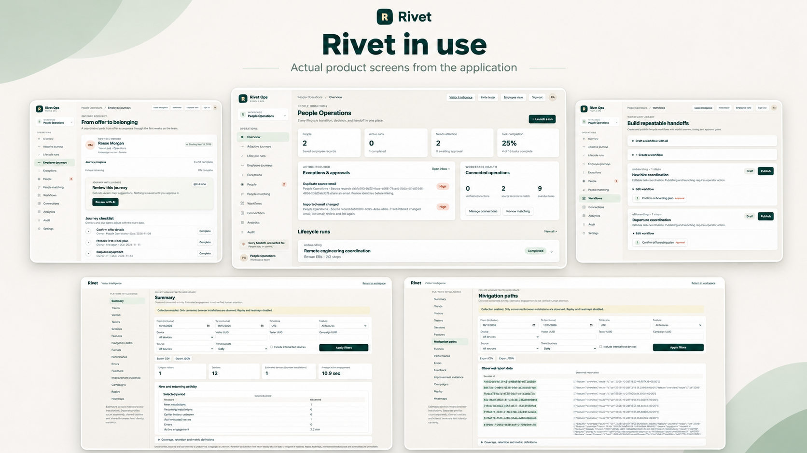
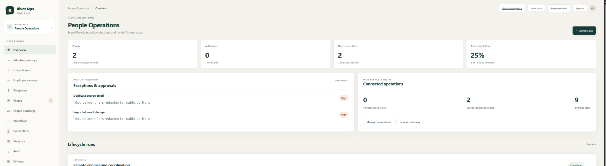
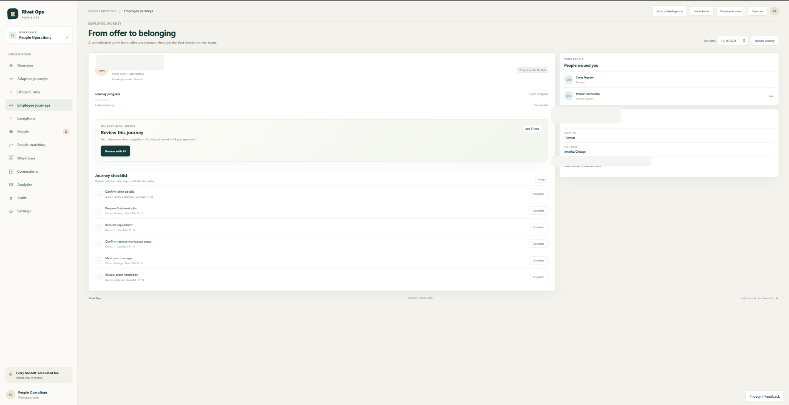
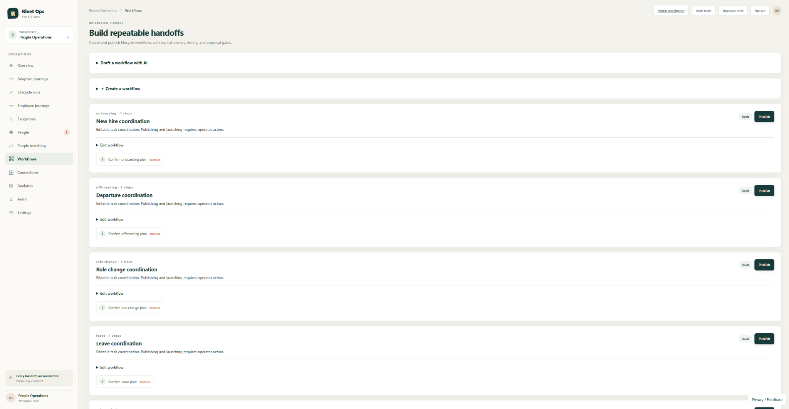

# RIVET
## People operations coordinated. Human decisions preserved.

**A deployed product engineering case study from the Rivet project**  
**For future development clients, engineering employers, and implementation teams · November 13, 2026**

[**Live workspace**](https://rivet-production-7d9c.up.railway.app/) · [**Full competitive analysis**](COMPARISON.md) · [**Individual feature inventory**](FEATURE-MATRIX.md)

---

### Systems of record hold employee data. Rivet holds the decisions and handoffs.

People operations crosses ATS data, HRIS records, IT responsibilities, manager approvals and employee tasks; the information is not always consistent or even about the same identity. Rivet is designed as the **orchestration layer above those systems**, not a proprietary replacement for their underlying records.

Rivet creates a persistent answer to four questions: **Who is this person? What should happen next? Who must approve it? What actually happened?**

## The actual application in use

*The showcase above is a **designed derivative** and is not an unmodified browser capture. The following are genuine user-supplied screenshots, with selected names, email addresses and private analytics details redacted for public display.*

| Overview | Journeys | Workflows |
|---|---|---|
|  |  |  |

**Visible software behaviors:** Overview shows exception/approval triage and connected-operations status; Employee Journeys shows role-aware tasks and AI suggestions awaiting review; Workflows shows draft definitions and explicit Publish controls. The private, consent-based Visitor Intelligence dashboard and Navigation Paths views appear separately, with usage counts and session identifiers obscured, in [SCREENSHOTS.md](SCREENSHOTS.md).

## Six engineering strengths

| Strength | Evidence in the current application |
|---|---|
| **1. A durable lifecycle ledger** | Versioned workflow definitions, frozen run snapshots, task outcomes, author/timestamp audit, pause/resume and explicit exceptions |
| **2. Human-controlled transitions** | Draft/publish separation, owner-only publication, approval-required gates for consequential lifecycle work, role-specific participant actions |
| **3. Reconciliation without overwriting** | Staged external records, explicit link/create/ignore choices, source-specific stable IDs, email-change invalidation, duplicate-link protection |
| **4. Adaptive journeys** | Task/content/form/acknowledgment/approval modules; dependencies and condition evaluation; timezone-aware dates, reminders, role-scoped access |
| **5. Connected but bounded integrations** | Read-sync adapters for Slack directories, Ashby candidates and BambooHR employee directory; an individually approved Slack send with uncertain-outcome handling |
| **6. Full-stack product delivery** | Node.js/Express-style HTTP service, PostgreSQL tenant isolation/RLS, locally supported SQLite, owner/operator roles, model-assisted draft review and protected analytics |

## One workflow, three important boundaries

**Person identity is reconciled, never silently overwritten.** An incoming candidate or directory record is staged. A human chooses the existing person, creates a new person, or ignores it; a changed email or ambiguous identity opens review instead of performing automatic merges.

**An AI draft is editable, not authoritative.** OpenAI-assisted workflow/journey drafting produces structured proposals. Owners review and publish them; launch is a further separate action. For high-impact offboarding and role changes, the current rules insist on approval prerequisites.

**A connector outcome is not assumed successful.** Slack sends require exact text/channel approval and a durable request ID. A timeout is treated as **outcome unknown**, not permission to resend blindly. Ashby/BambooHR adapters do not write to external HR systems.

## Adaptive lifecycle journeys

A workflow definition can contain content, tasks, fields, acknowledgments and manager approvals. The current code validates dependencies and rejects cycles; it freezes launched definition versions, schedules actions relative to an anchor date in an IANA time zone, enforces ownership and creates scoped participant links. A purpose-specific, HMAC-authenticated `candidate.hired` event enters a **pending identity-review queue**, not an automatically approved hire.

**Example sequence (representative process, not a claim of a particular customer run):** candidate event → identity match → manager approval → equipment request form → employee acknowledgment → due-date reminders → readiness summary.

## Competitive positioning — where the distinction really is

**Rippling** combines HR, IT, payroll, device management, policies and hundreds of integrations; it has materially broader automatic provisioning and system-of-record capabilities. **HiBob** is a mature people platform with modern workflow/agent functions and native U.S./U.K. payroll. **BambooHR** delivers HRIS records, onboarding paperwork, signatures and a U.S. payroll add-on. **Moxo** provides substantial AI-and-human orchestration including external users, approvals, integrations and rich process operations. The value proposition for Rivet is **the deliberately narrow, inspectable reconciliation-and-handoff ledger on top of systems a team already uses**—not exclusive ownership of approvals, workflows or AI features.

[**Read the source-linked side-by-side**](COMPARISON.md).

## Clear release and product limitations

- The code is **private** and the Railway service has an authenticated application deployment; it is not a fully self-serve, commercially billed SaaS.
- The current operational connectors are **Slack, Ashby and BambooHR**, using customer-supplied credentials; live vendor-account entitlements were not independently exercised for this report.
- A signed *candidate.hired* ingress exists, but **general vendor webhook ingestion and OAuth integration are not delivered**.
- No automated payroll, app/device provisioning, HRIS/ATS write-back, interactive Slack approval buttons, enterprise SSO/SCIM or recurring billing is claimed.
- Rivet's private **Visitor Intelligence** is consent-based and was tested with synthetic sessions. It is a separate administrative analytics system—not an employee surveillance tool or a public dashboard.

## Proof of delivery

Railway shows successful web and migration deployments of commit **`87beafb281a0`** on October 26, 2026. The project's documented disposable-PostgreSQL test run recorded **233 passed, 0 failed**. The richer feature branch is still a draft PR against older `main`; the release/merge discrepancy is flagged for operations rather than hidden in marketing.

**Technical stack:** JavaScript/Node 24+, PostgreSQL and tenant-scoped queries, SQLite local mode, browser UI, crypto-backed connectors, scoped participant tokens, an AI model integration, data protection and operational telemetry.

**The project demonstrates an engineered workflow product—not a slide-deck prototype and not a replacement for comprehensive HCM suites.**

[Architecture](ENGINEERING.md) · [Verified source status](VERIFICATION-AND-STATUS.md) · [All features](FEATURE-MATRIX.md) · [Source methodology](METHODOLOGY.md)
