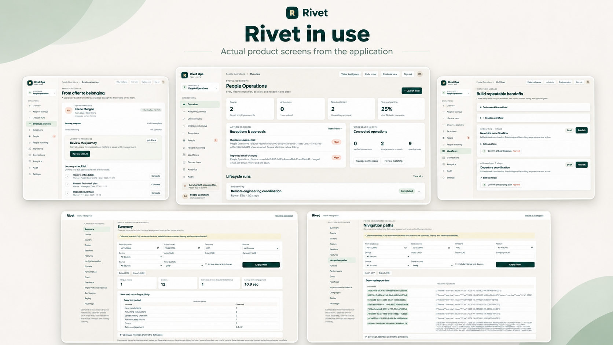
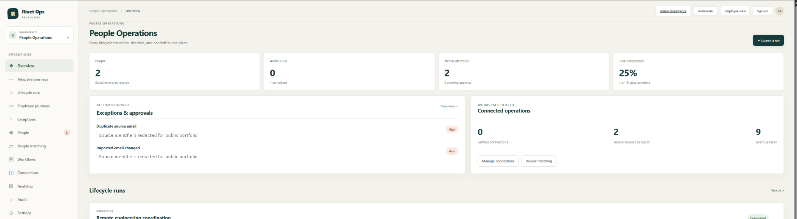
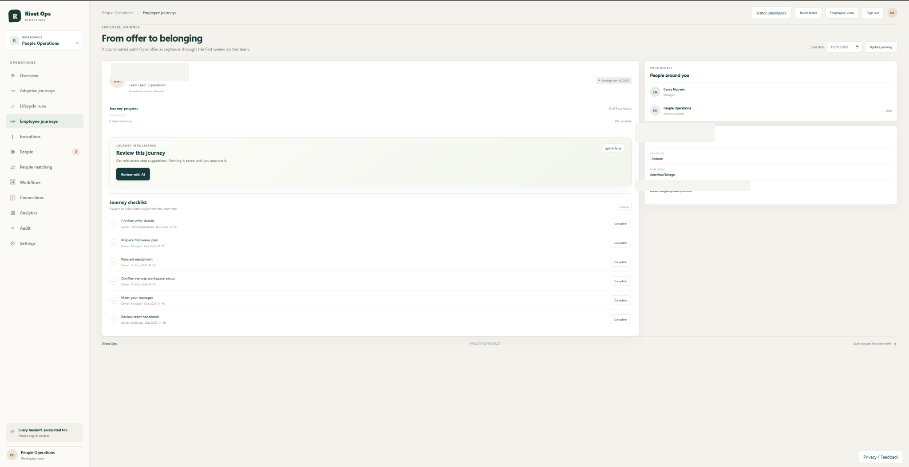
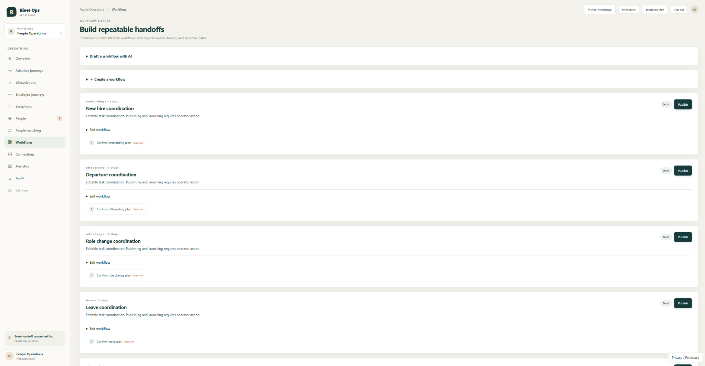

# RIVET
### People operations coordinated. Human decisions preserved.

**Private source, public-safe product engineering portfolio · November 13, 2026**  
Prepared for prospective engineering employers, implementation clients and software-development partners.

**[Open the live Rivet workspace](https://rivet-production-7d9c.up.railway.app/)** (authentication required) · [Portfolio brochure](BROCHURE.md) · [Four-vendor comparison](COMPARISON.md) · [Feature-by-feature audit](FEATURE-MATRIX.md) · [Visual presentation](index.html)

---

## Rivet in use — genuine application screens

*The showcase is a designed **composite interpretation** of the user-provided app captures, not a pixel-exact or newly captured browser screenshot. Inspect the **redacted original app screenshots** below or in [SCREENSHOTS.md](SCREENSHOTS.md).*

| People Operations | Employee journey | Workflows |
|---|---|---|
|  |  |  |

The private Visitor Intelligence pages are also shown in [the screenshot gallery](SCREENSHOTS.md), with audience metrics and session IDs concealed. Screens were supplied from the app on November 14, 2026.

## Rivet in one sentence

Rivet is a **vendor-neutral people-operations orchestration and ledger layer** for coordinating employee lifecycle work **on top of** existing HR and recruiting systems: it connects named responsibilities, immutable workflow versions, explicit human approval gates, identity reconciliation, exception handling and evidence of what occurred.

It is **not** an HRIS, payroll system, universal connector marketplace or automated device-provisioning suite.

## The core product journey

**Import a source record → explicitly match the person → select a versioned workflow → review/publish the plan → run conditional tasks → require named approvals → record exceptions and outcomes → examine the audit ledger.**

A deeper **Adaptive Journeys** subsystem adds dependent tasks, forms, acknowledgments, owner/manager/IT/HR assignments, timezone-specific schedules, participant-only access links, conditional steps, source-event review and reminders.

## What this package contains

| File | Purpose |
|---|---|
| [SCREENSHOTS.md](SCREENSHOTS.md) | Owner-supplied real UI screenshots, publicly redacted, plus a clearly labeled designed composite |
| [BROCHURE.md](BROCHURE.md) | Employer/client marketing case study, positioning and product strengths |
| [COMPARISON.md](COMPARISON.md) | Detailed side-by-side versus Rippling, HiBob, BambooHR and Moxo |
| [FEATURE-MATRIX.md](FEATURE-MATRIX.md) | Source-mapped, individually itemized capabilities and gaps |
| [ENGINEERING.md](ENGINEERING.md) | Architecture, data authority, lifecycle controls, integration boundaries |
| [VISITOR-INTELLIGENCE.md](VISITOR-INTELLIGENCE.md) | Private, consent-based analytics with explicit limits |
| [VERIFICATION-AND-STATUS.md](VERIFICATION-AND-STATUS.md) | Exact deployment branch/commit, recorded tests, readiness boundaries |
| [METHODOLOGY.md](METHODOLOGY.md) | Current source pointers and competitor-owned references |
| [index.html](index.html) | Responsive navy/teal visual brochure; includes a grounded illustrative architecture diagram |
| [Rivet_Portfolio_Brochure.pdf](Rivet_Portfolio_Brochure.pdf) | Printable visual brochure with appended screenshot evidence |

## Evidence, not inflated claims

The private repository's **`main`** branch remains at `2e3065d97b68`, while the October 26 **deployed application** is feature-branch commit **`87beafb281a0`**. The feature-branch HEAD contains later documentation updates. Source verification and Railway match the deployed application SHA; the comparison is not based on an obsolete default branch.

The October 26 verification records **233 tests passed**, with disposable PostgreSQL/database checks. Recorded live production verification includes a private Visitor Intelligence dashboard and synthetic consented sessions; it does not establish genuine visitor conversion or a production traffic performance SLA. Details are in [VERIFICATION-AND-STATUS.md](VERIFICATION-AND-STATUS.md).

**Rivet's completed controls are a useful proof of engineering, but OAuth, general vendor webhooks, HRIS/ATS write-back, enterprise SSO/SCIM, commercial subscription billing, broad connector depth and automated payroll/provisioning are not shipped.** A narrowly scoped *signed `candidate.hired` source-event receiver* exists for Adaptive Journeys; that is distinct from general vendor-signed webhooks.

**The private Rivet application and personnel data have not been published or changed by this package.**
