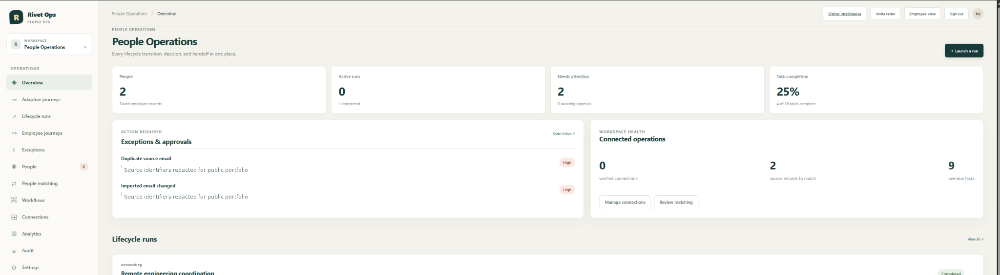
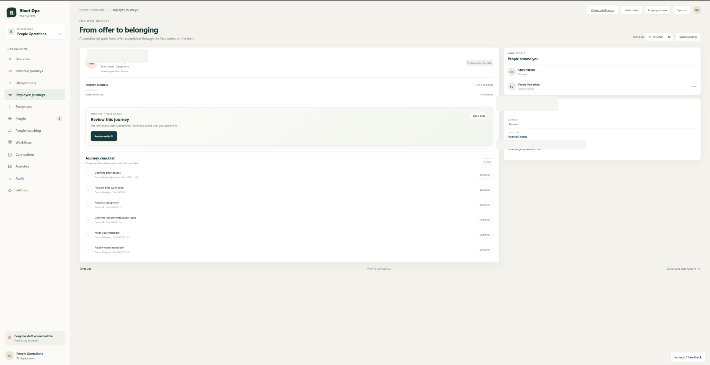
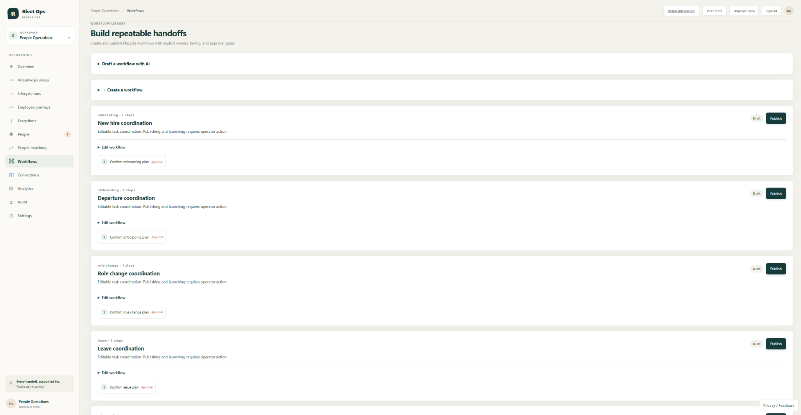
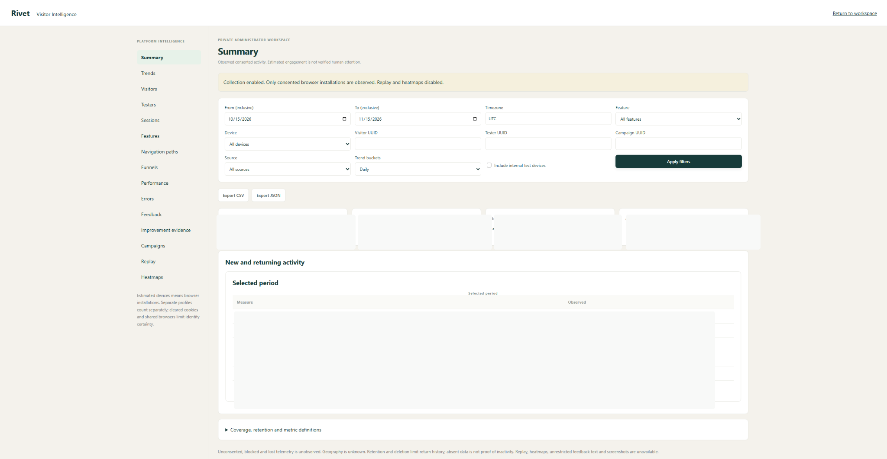
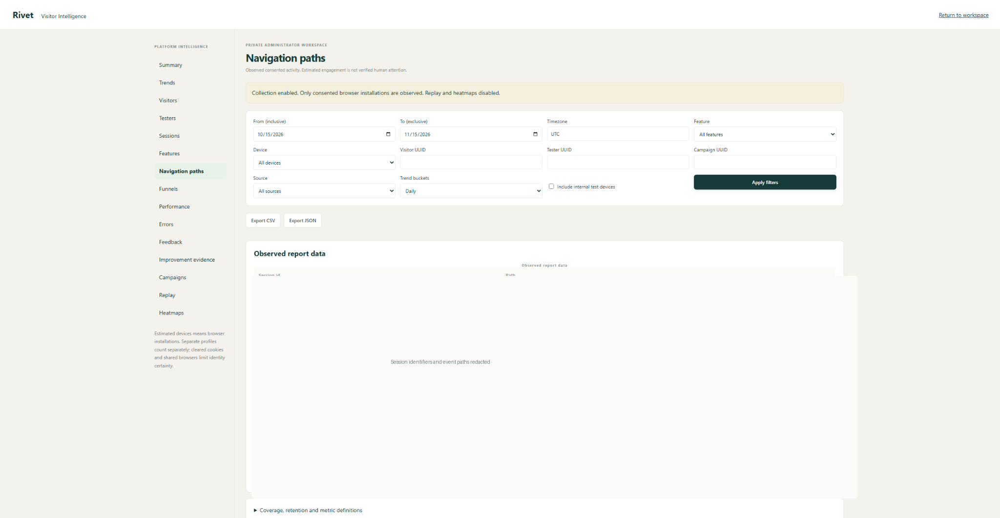
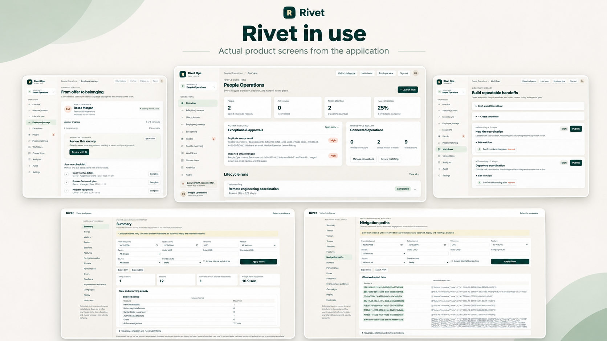

# Rivet — Screens from the Working Application

**Source:** Five screenshots supplied by the project owner on November 14, 2026. These are screenshots of the actual Rivet interface, **not AI-generated mockups**. Selected email addresses, participant identifiers, analytics counts and session IDs have been cropped or redacted for this public portfolio.

## People Operations overview

Shows active work, exception/approval requests, connected operations, overdue work, and the recent lifecycle-run state. The activity table containing an operator email was cropped from this public copy.

## Employee Journeys

An onboarding journey with a progress checklist, owner assignments, scheduled actions, and a **Review with AI** control that states suggestions are not saved without approval. Participant details are redacted.

## Workflow library

Shows draft workflows for new hires, departures, role changes and leave, with operator-controlled **Publish** actions and approval-required tasks.

## Visitor Intelligence summary (private administrative surface)

Shows consent-dependent event collection, filters, export controls and reporting structures. The public copy hides observed traffic counts and raw metrics.

## Visitor Intelligence navigation paths (private administrative surface)

Shows the path-report structure and filtering. Session identifiers and event-path payloads are redacted.

## Designed presentation composite

The image above was a **generated promotional composite referencing the five supplied screens**. It is not presented as an original, pixel-identical browser capture; use the individual images above for authentic interface evidence.

[Portfolio home](README.md) · [Brochure](BROCHURE.md) · [Engineering details](ENGINEERING.md) · [Live Rivet application](https://rivet-production-7d9c.up.railway.app/)
